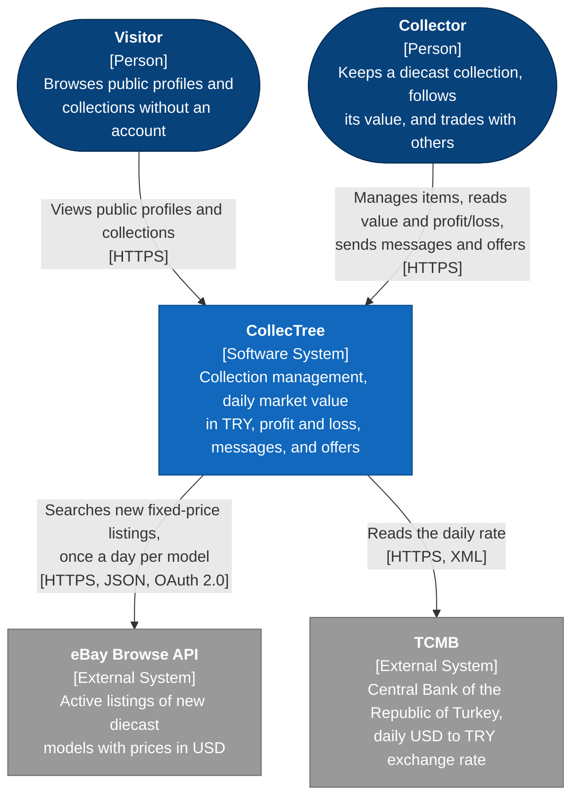
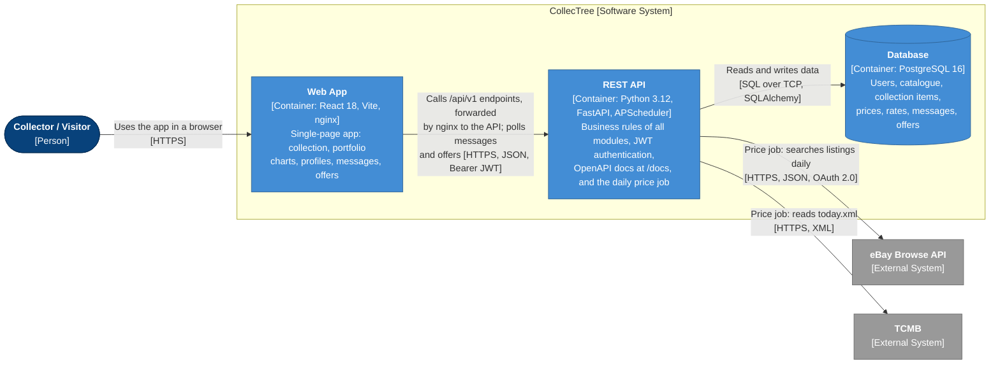
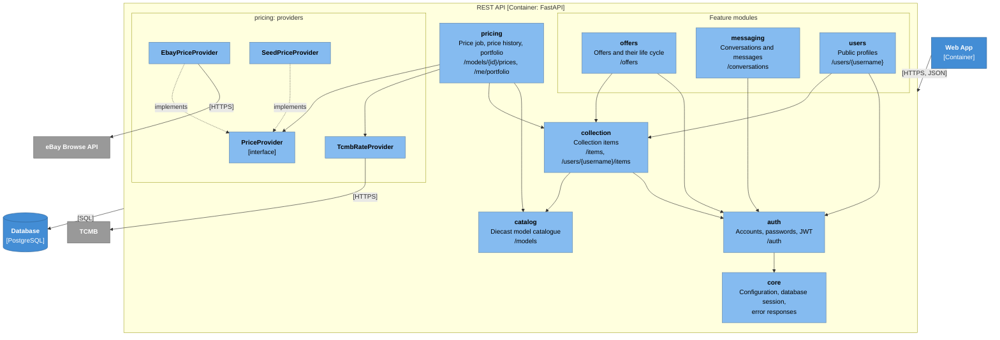

# C4 Model

| Field | Value |
|---|---|
| Project | CollecTree |
| Course | BM 321 / SENG 321 Software Engineering — Sprint 2 |
| Version | 0.2.0 (draft) |
| Owner (Accountable) | Berke Akman — Lead Software Architect |
| Consulted | Çağrı Baynal (DevOps), Ata Eren Atlı (Implementation) |
| Informed | Elif Zahide Arat (Product Owner), Kemal Yusuf Ateşer (QA), Feyza Sayar (Scrum Master) |
| Sources | [ADR-001](../adr/ADR-001-architecture-style-and-technology-stack.md), [system boundary](system-boundary.md), [domain model](domain-model.md), [`api/openapi.yaml`](../../api/openapi.yaml) |

This document describes the CollecTree architecture at three levels of the [C4 model](https://c4model.com): the system in its environment (Level 1), the deployable containers (Level 2), and the components inside the backend (Level 3). Level 4 (code) is described by the UML class diagram in the [domain model](domain-model.md).

The price source shown here (eBay Browse API and TCMB) is the proposal under test in the price source spike (#96). If the spike fails, only the external systems in Level 1 and the price providers in Level 3 change; the rest of the architecture stays the same because prices are read through the `PriceProvider` interface.

**Notation:** blue boxes are part of CollecTree, grey boxes are external systems, rounded boxes are people. Every arrow names its purpose and, in brackets, its protocol.

---

## 1 Level 1: System Context

| Element | Responsibility | Trust and failure handling |
|---|---|---|
| Visitor | Reads public data only | Not authenticated; purchase prices are never shown (BR-02) |
| Collector | Owns a collection, messages, and offers | Authenticated with a JWT; can change only their own data (BR-03) |
| eBay Browse API | Source of the daily market price | Only an aggregated median and sample size are stored, never listing or seller data. If eBay fails, the last known price stays and the seed provider can replace eBay (R-1) |
| TCMB | Source of the USD to TRY rate | No rate on weekends and holidays: the last known rate is reused and marked as stale |

**Outside the boundary:** payments, shipping, and the exchange of the items themselves. Accepted offers are completed by the users outside the platform (BR-10). Turkish listing sites are not used as a price source because their terms of use and `robots.txt` forbid automated collection (#96).

---

## 2 Level 2: Containers

| Container | Technology | Responsibility | Docker Compose service |
|---|---|---|---|
| Web App | React 18, Vite, React Router, Recharts; production build served by nginx | Screens and client-side validation. Holds no business rules; every rule is checked again by the REST API. Stores the JWT in memory and session storage. nginx also forwards `/api` to the REST API, so the browser uses one address | `frontend` |
| REST API | Python 3.12, FastAPI, Pydantic, SQLAlchemy 2, Alembic, APScheduler | Implements `api/openapi.yaml`, all business rules (BR-01 to BR-19), authentication, and authorization. Also runs the daily price job (section 3.3) | `backend` |
| Database | PostgreSQL 16 | Stores all persistent data ([domain model](domain-model.md), section 2). Constraints enforce BR-01, BR-12, and BR-15 | `db` |

### 2.1 Decisions at this level

| Decision | Reason |
|---|---|
| The price job runs inside the REST API process, not as a separate container | ADR-001: one backend application keeps Docker Compose small. The job is light (about one call per model per day). It can move to its own container later without code changes because it only uses the `pricing` module |
| Messages and offers are refreshed by polling, not WebSocket | ADR-001: simpler to build and test; real-time chat is a deferred improvement |
| nginx in the `frontend` container forwards `/api` to the REST API (#114) | The browser talks to one address, so no CORS configuration is needed, and only one port is published ([deployment](deployment.md)) |
| The database is reachable only from the `backend` container | The web app never talks to the database; all access goes through the business rules in the API |
| Secrets (database password, JWT secret, eBay keys) come from environment variables | They are set in a local `.env` file that is never committed (see `.env.example`, #94) |

---

## 3 Level 3: Components of the REST API

The REST API is a modular monolith (ADR-001). Each module has its own router (HTTP layer), service (business rules), and data access (SQLAlchemy models for its own tables).

Arrows show "uses the service of". Every module also uses `core`; those arrows are left out for readability.

### 3.1 Components

| Component | Responsibility | Owns tables | Endpoints | Business rules |
|---|---|---|---|---|
| `core` | Settings from environment variables, database session per request, RFC 7807 error responses (`Problem`) | – | – | – |
| `auth` | Registration, login, password hashing (bcrypt), JWT issue and validation, current user | `users` | `/auth/register`, `/auth/login`, `/auth/me` | BR-01 |
| `catalog` | Searching and reading catalogue models; loading the seed catalogue | `diecast_models` | `/models` | – |
| `collection` | Adding, changing, listing, and soft-deleting items; hiding private fields | `collection_items` | `/items`, `/items/{itemId}`, `/users/{username}/items` | BR-02, BR-03, BR-04, BR-19 |
| `pricing` | Daily price job, price history, current price, portfolio value and history | `price_snapshots`, `exchange_rates` | `/models/{modelId}/prices`, `/me/portfolio`, `/me/portfolio/history` | BR-13, BR-14, BR-15 |
| `pricing` providers | `PriceProvider` returns a median USD price and sample size for a search keyword. `EbayPriceProvider` calls eBay; `SeedPriceProvider` reads the seed file and is used in tests and when `PRICE_PROVIDER=seed`. `TcmbRateProvider` returns the daily rate | – | – | – |
| `users` | Public profile with item count | – (reads through `auth` and `collection`) | `/users/{username}` | – |
| `messaging` | Starting conversations, sending and reading messages | `conversations`, `messages` | `/conversations`, `/conversations/{id}/messages` | BR-11, BR-12 |
| `offers` | Creating offers and changing their status; cancelling other offers and closing items for trade on acceptance | `offers`, `offer_items` | `/offers`, `/offers/{offerId}` | BR-06 to BR-10, BR-16, BR-17 |

### 3.2 Dependency rules

These rules keep the modules independent, so that each can be built and tested by a different team member. Reviewers check them (code review guidelines, "module boundaries").

1. **A module reads and writes only its own tables.** It uses another module only by calling that module's service, never its tables or SQLAlchemy models. Example: `offers` asks `collection` whether an item belongs to the sender; it does not query `collection_items`.
2. **Services depend only on modules lower in this order:** `core` → `auth` → `catalog` → `collection` → `pricing` → (`offers`, `messaging`, `users`). There are no cycles. `offers` and `messaging` never use each other.
3. **Routers may combine services of several modules** to build one response. Example: the `/models` router adds `currentPrice` from `pricing` to the models returned by `catalog`.
4. **When a lower module needs a rule from a higher one, the router checks it in the same database transaction.** Removing an item (BR-05) and closing it for trade (BR-18) need to know about pending offers. The `collection` router locks the item row, asks `offers` for pending offers, and then calls `collection`. Creating and accepting offers lock the same item rows, so the check cannot be bypassed by two requests at the same time.
5. **External systems are reached only through provider interfaces** in `pricing`. Tests use `SeedPriceProvider` and a fixed rate, so no test calls eBay or TCMB.

### 3.3 Daily price job

1. At 06:00 Europe/Istanbul, the job asks `TcmbRateProvider` for today's USD to TRY rate. If there is no new rate (weekend or holiday), it reuses the last one and marks it as stale.
2. It asks `catalog` for every model and its search keyword.
3. For each model it asks the selected `PriceProvider` for the median price and the sample size.
4. If the sample size is at least 5, it stores the price in USD and TRY with the rate date (BR-15: one row per model per day). Otherwise it keeps the last price.
5. One failed model does not stop the job; errors are logged and the next model is processed.

The detailed sequence diagram is in the UML document.
