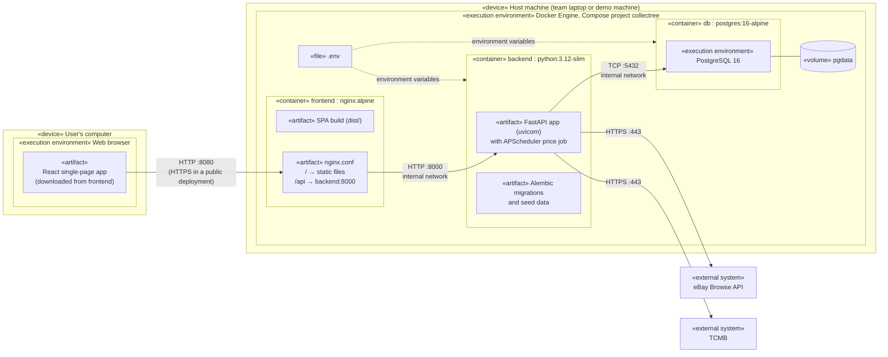

# Deployment

| Field | Value |
|---|---|
| Project | CollecTree |
| Course | BM 321 / SENG 321 Software Engineering — Sprint 2 |
| Version | 0.2.0 |
| Owner (Accountable) | Berke Akman — Lead Software Architect |
| Responsible for the Docker setup | Çağrı Baynal — DevOps and CI/CD Infrastructure Engineer |
| Decisions | Docker Compose decisions by the DevOps engineer: [#114](https://github.com/SENG321-TEAM-1/CollecTree/issues/114) (2026-11-17) |
| Sources | [C4 model](c4-model.md), Level 2; [ADR-001](../adr/ADR-001-architecture-style-and-technology-stack.md); [`.env.example`](../../.env.example) |

> **Status:** agreed. The architect proposed the values below, and the DevOps engineer confirmed all of them in the Docker Compose decisions issue [#114](https://github.com/SENG321-TEAM-1/CollecTree/issues/114). The Docker files that implement them are written in Sprint 3.

The whole system runs on **one machine with Docker** and starts with **one command** (course requirement, constraint in the [system boundary](system-boundary.md)). The same setup is used for development, for the demo, and for the jury.

---

## 1 UML deployment diagram

Only port **8080** of the `frontend` container is published to the host. The `backend` and `db` containers are reachable only inside the Compose network, so the database can never be reached from outside, and the browser talks to one address only (no CORS configuration needed).

---

## 2 Services

| Service | Image | Published port | Depends on | Health check | Responsibility |
|---|---|---|---|---|---|
| `frontend` | Built from `./frontend/Dockerfile`: stage 1 `node:22` builds the app, stage 2 `nginx:alpine` serves it | `8080:80` | `backend` | HTTP `GET /` | Serves the web app and forwards `/api` to the backend |
| `backend` | Built from `./backend/Dockerfile`, based on `python:3.12-slim` | none (`8000` internal) | `db` (healthy) | HTTP `GET /api/v1/health` | REST API, business rules, daily price job |
| `db` | `postgres:16-alpine` | none (`5432` internal) | – | `pg_isready` | Stores all data in the `pgdata` volume |

| Volume | Mounted in | Holds | Survives `docker compose down` |
|---|---|---|---|
| `pgdata` | `db` at `/var/lib/postgresql/data` | All database data | Yes. Only `docker compose down -v` deletes it |

**Environment variables** come from `.env`, which each developer creates from `.env.example`. The file is never committed (#94).

| Variable | Used by | Purpose |
|---|---|---|
| `POSTGRES_DB`, `POSTGRES_USER`, `POSTGRES_PASSWORD` | `db`, `backend` | Database name and credentials |
| `DATABASE_URL` | `backend` | Connection string to `db` |
| `JWT_SECRET`, `JWT_EXPIRE_MINUTES` | `backend` | Signing and lifetime of login tokens |
| `PRICE_PROVIDER` | `backend` | `seed` (default) or `ebay` ([ADR-003](../adr/ADR-003-market-price-and-exchange-rate-source.md)) |
| `EBAY_ENVIRONMENT`, `EBAY_CLIENT_ID`, `EBAY_CLIENT_SECRET` | `backend` | eBay keyset; only needed when `PRICE_PROVIDER=ebay` |
| `TCMB_RATES_URL` | `backend` | Address of the daily exchange rates |

---

## 3 Start-up order

1. `db` starts and becomes healthy when `pg_isready` succeeds.
2. `backend` starts only after `db` is healthy. It runs `alembic upgrade head`, loads the seed catalogue if the catalogue is empty, starts the price scheduler, and then starts uvicorn.
3. `frontend` starts and serves the web app. Requests to `/api` are forwarded to `backend`.

Loading the seed data only when the catalogue is empty makes the start-up **idempotent**: restarting the system never duplicates data.

---

## 4 Operating the system

These commands are what the team shows in the demo ("deployment, data handling, and recovery").

| Task | Command | Result |
|---|---|---|
| First start | `cp .env.example .env` and then `docker compose up --build` | Builds the images, creates the database, loads the seed data, opens the app at `http://localhost:8080` |
| Stop | `docker compose down` | Containers stop; data stays in `pgdata` |
| Start again | `docker compose up` | The same data is back |
| Restart one service | `docker compose restart backend` | The API restarts; the web app and data are not affected |
| Reset to a clean demo state | `docker compose down -v` and then `docker compose up --build` | The volume is deleted; the database is created again with only the seed data |
| Back up the database | `docker compose exec db pg_dump -U collectree collectree > backup.sql` | A SQL file with all data on the host |
| Restore a backup | `docker compose exec -T db psql -U collectree collectree < backup.sql` | The data from the backup is loaded into an empty database |
| Read the logs | `docker compose logs -f backend` | API requests and the price job summary |

---

## 5 Failure and recovery

| Failure | What the user sees | Recovery |
|---|---|---|
| eBay is not reachable or production access is missing | Prices stay at their last known value | Automatic: the job keeps the last price and continues (NFR-REL-01). Long term: `PRICE_PROVIDER=seed` |
| TCMB is not reachable, or it is a weekend or holiday | Prices use the last known rate | Automatic: the last rate is reused and marked as stale (NFR-REL-02) |
| The `backend` container stops | The web app shows an error for every action | `docker compose up -d backend`; no data is lost |
| The `db` container stops | The API returns errors | `docker compose up -d db`; data is kept in `pgdata` (NFR-REL-04) |
| The database is damaged or the demo data is wrong | Wrong or missing data | Restore the last backup, or reset to the seed data (section 4) |

---

## 6 Decisions

The DevOps engineer decided the open points of the draft in [#114](https://github.com/SENG321-TEAM-1/CollecTree/issues/114) on 2026-11-17:

| Open point | Decision | Where it is applied |
|---|---|---|
| Images and versions | Final: `postgres:16-alpine`, `python:3.12-slim`, `node:22` (build stage), `nginx:alpine` | Section 2 |
| nginx as the reverse proxy for `/api` | Agreed: nginx serves the frontend build and forwards `/api` to `backend:8000`, so no CORS configuration is needed | Section 1; the [C4 container diagram](c4-model.md) shows the forwarding |
| Health endpoint for the `backend` | Agreed: `GET /api/v1/health` returns 200 when the API and the database are reachable | Section 2; `getHealth` in `api/openapi.yaml` |
| Loading the seed data | Agreed: the backend loads it at start-up when the catalogue is empty, right after `alembic upgrade head` | Section 3 |
