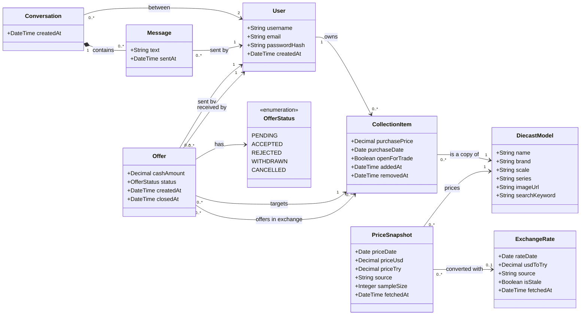
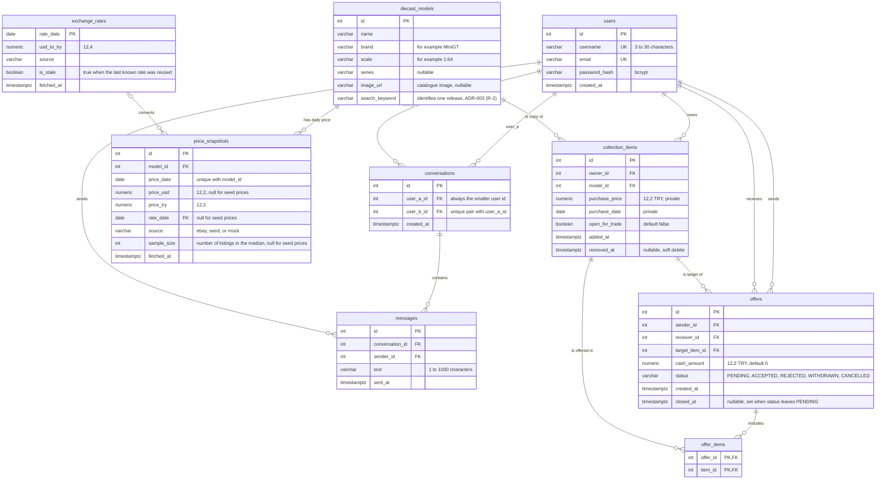
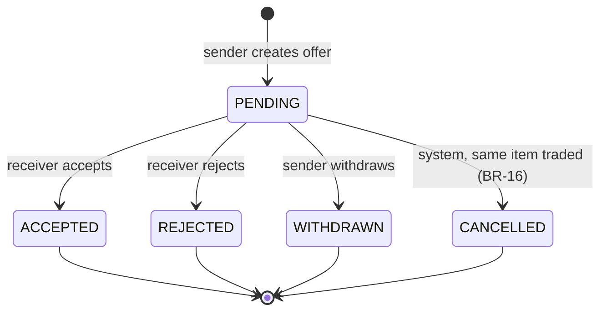

# Domain Model and Database Schema

| Field | Value |
|---|---|
| Project | CollecTree |
| Course | BM 321 / SENG 321 Software Engineering — Sprint 2 |
| Version | 0.2.0 (draft) |
| Owner (Accountable) | Berke Akman — Lead Software Architect |
| Consulted | Elif Zahide Arat (Product Owner), Ata Eren Atlı (Implementation), Kemal Yusuf Ateşer (QA) |
| Informed | Feyza Sayar (Scrum Master), Çağrı Baynal (DevOps) |
| Sources | [`api/openapi.yaml`](../../api/openapi.yaml), [product backlog](../requirements/product-backlog.md), [system boundary](system-boundary.md), [ADR-001](../adr/ADR-001-architecture-style-and-technology-stack.md) |

This document defines the business objects of CollecTree, the rules between them, and the PostgreSQL tables that store them. The SRS data requirements, the Figma screens, the UML diagrams, and the Sprint 3 implementation all use the names defined here. A change to this model must update `api/openapi.yaml` in the same pull request.

---

## 1 Domain model

The domain model shows the business objects and how they relate, without database details.

### 1.1 Business objects

| Object | Meaning | Owned by module (ADR-001) |
|---|---|---|
| User | A registered collector. A visitor without an account is not stored. | `auth`, `users` |
| DiecastModel | One specific release in the shared catalogue, for example "MiniGT Nissan Skyline GT-R (R34) V-Spec Lightning Yellow (MGT00762), 1:64". Different colours, catalogue numbers, and chase versions of the same casting are different models, because their market prices differ (ADR-003). The team prepares the catalogue as seed data (AS-3); users cannot add models in the first release. | `catalog` |
| CollectionItem | One physical copy of a model that a user owns, with what they paid and when. A user can own several copies of the same model. | `collection` |
| PriceSnapshot | The new-in-box market price of a model on one day, collected by the daily price job. | `pricing` |
| ExchangeRate | The USD to TRY rate of one day, used to convert prices from the price source. | `pricing` |
| Portfolio | Not stored. The total value and profit or loss of a user's collection, calculated from collection items and price snapshots when requested. | `pricing` |
| Conversation | A private message thread between exactly two users. | `messaging` |
| Message | One text message in a conversation. | `messaging` |
| Offer | A formal proposal from one user for another user's item. It can contain the sender's items, cash, or both. | `offers` |

---

## 2 Database schema (ER diagram)

The tables follow the domain model. All tables use an integer `id` as primary key, matching the integer ids in the OpenAPI contract. Money is stored as `numeric(12,2)`, never as floating point. Times are stored as `timestamptz` in UTC.

### 2.1 Constraints and indexes

| Table | Constraint or index | Why |
|---|---|---|
| `users` | Unique `username`, unique `email` (case-insensitive) | Register returns 409 when either is used |
| `collection_items` | Check `purchase_price >= 0`; index on `owner_id`; index on `model_id` | Listing a user's collection and the daily price job |
| `price_snapshots` | Unique (`model_id`, `price_date`) | One price per model per day; running the job twice on one day does not duplicate prices |
| `conversations` | Check `user_a_id < user_b_id`; unique (`user_a_id`, `user_b_id`) | Exactly one conversation per pair of users, even if two requests arrive at the same time (README risk: duplicate DMs) |
| `messages` | Index on (`conversation_id`, `sent_at`) | Messages are read in time order |
| `offers` | Check `status in (...)`; check `cash_amount >= 0`; check `sender_id <> receiver_id`; index on `sender_id`, `receiver_id`, `target_item_id` | Valid states and fast "my offers" lists |
| `offer_items` | Primary key (`offer_id`, `item_id`) | The same item cannot appear twice in one offer |

### 2.2 Design decisions

| Decision | Reason | Alternative not chosen |
|---|---|---|
| **Soft delete for collection items** (`removed_at`) | The profit and loss chart (`GET /me/portfolio/history`) must show what the user owned on each past day. If removed items were deleted, past points of the chart would change. Offers that point to a removed item also stay readable. | Hard delete: simpler, but breaks the history chart and offer history |
| **Portfolio is calculated, not stored** | The values come directly from `collection_items` and `price_snapshots`, so they can never get out of sync. The expected data size (hundreds of items per user) is small. | A daily `portfolio_snapshots` table: faster, but one more job that can fail; can be added later if needed |
| **Price stored in both USD and TRY** with the rate date | The price source returns USD (system boundary). Keeping both values shows exactly how each TRY price was calculated. Seed prices are collected in TRY, so their USD value and rate date are empty. | Storing TRY only: loses the original value when a rate is wrong |
| **One catalogue model per release, with a release-specific `search_keyword`** | One casting is sold in several colours, catalogue numbers, and chase versions with very different prices. A model for each release and a keyword that names it (for example `mini gt porsche gt3 rs (853,mgt00853)`) give one consistent price; the keyword syntax and the matching rule are in ADR-003. | One model per casting: simpler catalogue, but the price spike showed mixed, implausible medians for half of the models |
| **No eBay listing, seller, or user data is stored** | Only one calculated median price per model per day and the number of listings it was calculated from (`sample_size`) are stored. This keeps the data small and lets the team truthfully apply for eBay's "Not persisting eBay data" exemption from account deletion notifications. `sample_size` shows how reliable a price is. | Storing each listing URL or listing: more eBay data to protect and delete, no use for a median price |
| **Brand, scale, and series as text columns** | Matches the OpenAPI `DiecastModel` schema and the seed data. Filters work with a simple `WHERE`. | Separate `brands`, `scales`, `series` tables: cleaner, but more joins and seed files for no first-release benefit |
| **`receiver_id` stored on the offer** | The receiver is the owner of the target item when the offer is created. Storing it keeps "offers I received" correct and fast. | Reading it through the target item every time |
| **Conversation pair ordered by user id** | A database constraint, not only application code, prevents two conversations between the same users. | Checking in code only: fails under concurrent requests |
| **Accepting an offer runs in one database transaction with row locks** | The service locks the rows of every item in the offer (`SELECT ... FOR UPDATE`), checks that the offer is still `PENDING`, then accepts it, cancels the other affected offers, and closes the items for trade (BR-16, BR-17). If two offers for the same item are accepted at the same moment, the second waits, sees its offer is `CANCELLED`, and returns 409. | Checking without locks: two offers for one item could both be accepted |
| **`CANCELLED` is a separate status from `REJECTED`** | `REJECTED` is a decision of the receiver. `CANCELLED` is set by the system when the trade became impossible. Users see why their offer ended. | Reusing `REJECTED`: hides the real reason from the sender |

---

## 3 Business rules

These rules hold in every module. QA uses them as a source for test cases, and the SRS references them by ID.

| ID | Rule | Enforced in | API result when broken |
|---|---|---|---|
| BR-01 | Usernames and emails are unique. | Database | 409 on `POST /auth/register` |
| BR-02 | Purchase price and purchase date are visible only to the item's owner. | `collection` service | Fields are left out of the response |
| BR-03 | A user can change or remove only their own items. | `collection` service | 403 |
| BR-04 | Removed items are not listed and cannot be offered or targeted. | `collection`, `offers` services | 404 |
| BR-05 | An item that is the target of, or offered in, a `PENDING` offer cannot be removed. | `collection` service | 409 on `DELETE /items/{itemId}` |
| BR-06 | An offer contains at least one offered item or a cash amount greater than zero. | `offers` service | 400 |
| BR-07 | The target item must be open for trade and must not belong to the sender. | `offers` service | 409 if not open for trade; 403 if own item |
| BR-08 | Every offered item must belong to the sender. | `offers` service | 403 |
| BR-09 | Only a `PENDING` offer can change status. The receiver can accept or reject; the sender can withdraw. `CANCELLED` is set only by the system. | `offers` service | 403 for the wrong user; 409 if not pending; 400 if a user sends `CANCELLED` |
| BR-10 | Accepting an offer does not move items or money. The users complete the exchange outside the platform. | Scope rule | – |
| BR-16 | When an offer is accepted, every other `PENDING` offer that contains any of its items (as target or as offered item) becomes `CANCELLED`, because the trade has happened and those offers can no longer be fulfilled. | `offers` service, same transaction as the acceptance | The senders see `CANCELLED` in their offer list |
| BR-17 | When an offer is accepted, its target item and offered items are closed for trade (`open_for_trade = false`), so no new offers arrive for items that were already traded. | `offers` service, same transaction as the acceptance | – |
| BR-18 | An item cannot be closed for trade while it is the target of a `PENDING` offer. The owner first accepts or rejects those offers. | `collection` service | 409 on `PATCH /items/{itemId}` |
| BR-19 | Only the owner can change an item's purchase price, purchase date, and trade status. The model of an item cannot be changed; the owner removes the item and adds a new one instead. | `collection` service | 403 for another user; 400 when the request contains `modelId` |
| BR-11 | Only the two users of a conversation can read or send its messages. | `messaging` service | 403 |
| BR-12 | There is at most one conversation between two users. A user cannot start a conversation with themselves. | Database; `messaging` service | 409 on `POST /conversations` (the web app then opens the existing conversation); 400 for a conversation with oneself |
| BR-13 | The market price is always the new-in-box price; condition does not change it. | Scope rule | – |
| BR-14 | If a model has no price yet, its purchase price is used as its current value, so it adds zero profit or loss. In the portfolio history, an item counts from the day it was added (`added_at`) until the day it was removed (`removed_at`); on each day its value is the latest price on or before that day, or its purchase price if there is none. | `pricing` service | – |
| BR-15 | There is at most one price per model per day. | Database | The job updates the existing row |

### 3.1 Offer life cycle

All four end states are final. An ended offer cannot be reopened; the sender creates a new offer instead.

---

## 4 Mapping to the OpenAPI contract

| OpenAPI schema | Table(s) | Notes |
|---|---|---|
| `User` | `users` | `itemCount` is counted from `collection_items` where `removed_at` is null |
| `DiecastModel` | `diecast_models`, `price_snapshots` | `currentPrice` is the newest `price_try` of the model |
| `PricePoint` | `price_snapshots` | `date` = `price_date`, `price` = `price_try` |
| `CollectionItem` | `collection_items`, `users`, `diecast_models` | `owner` is the username |
| `NewCollectionItem`, `UpdateCollectionItem` | `collection_items` | `PATCH /items/{itemId}` changes only `purchase_price`, `purchase_date`, and `open_for_trade` (BR-19) |
| `Portfolio`, `PortfolioPoint` | Calculated from `collection_items` and `price_snapshots` | See BR-14 and the soft delete decision |
| `Conversation` | `conversations`, `messages` | `otherUser` is the user who is not the caller; `lastMessage` is the newest message |
| `Message` | `messages` | `sender` is the username |
| `Offer`, `NewOffer` | `offers`, `offer_items` | `offeredItemIds` come from `offer_items` |

---

## 5 Open questions

| ID | Question | Answer | Status |
|---|---|---|---|
| OQ-1 | When an offer is accepted, what happens to the other `PENDING` offers for the same items? | They become `CANCELLED`, because the trade has happened (BR-16, BR-17). | Decided 2026-11-14 |
| OQ-2 | The API has no endpoint to change an item (for example to set `openForTrade` or correct a price). | `PATCH /items/{itemId}` is added to `api/openapi.yaml` (BR-18, BR-19). | Decided 2026-11-14 |
| OQ-3 | Should a user see an offer's target item after the owner removes it? | Yes, as read-only history; this is why items are soft deleted. | Proposed |
| OQ-4 | Which price source do we use? | eBay Browse API for daily prices, TCMB for the USD to TRY rate, manually collected seed prices as fallback. Confirmed by the price source spike (#96) and recorded in ADR-003. | Decided 2026-11-19 |
