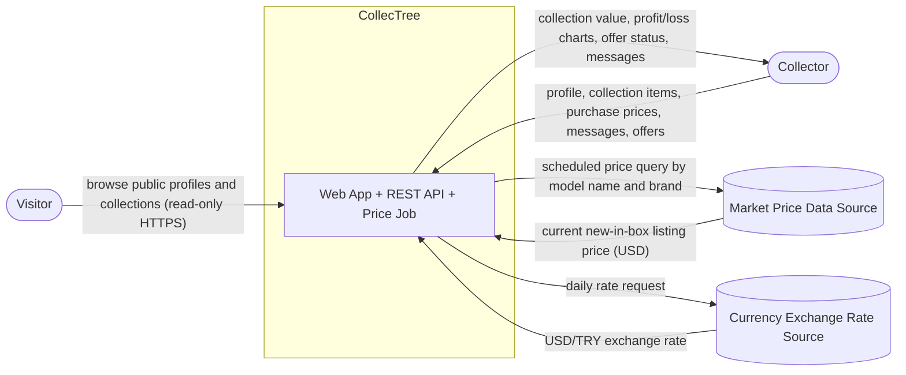

# System Boundary Specification

| Field | Value |
|---|---|
| Project | CollecTree |
| Course | BM 321 / SENG 321 Software Engineering — Sprint 1 |
| Version | 0.1.0 (draft) |
| Owner (Accountable) | Berke Akman — Lead Software Architect |
| Consulted | Elif Zahide Arat (Product Owner), Ata Eren Atlı (Implementation), Kemal Yusuf Ateşer (QA) |
| Informed | Feyza Sayar (Scrum Master), Çağrı Baynal (DevOps) |

The system vision and the in-scope / out-of-scope list are owned by the Product Owner and are in [README Section 2](../../README.md#2-system-vision-and-boundary). This document describes where the software boundary lies, which external systems it talks to, and what we assume and risk.

---

## 1 System Context Diagram

### 1.1 Relationship descriptions

| From | To | Information | Purpose | Trust assumption |
|---|---|---|---|---|
| Visitor | Platform | Public profile and collection requests | Discover collectors before signing up | Unauthenticated; read-only access to public data only |
| Collector | Platform | Account data, collection items, purchase prices, messages, offers | Manage portfolio and trade | Authenticated by JWT; users may modify only their own data |
| Platform | Collector | Valuation, charts, conversations, offer status | Show portfolio value and trade progress | Purchase prices are private to the owner unless shared |
| Platform | Market price source | Model search query | Find the current market price | External data may be missing or wrong; the platform stores source and timestamp with each price |
| Platform | Exchange rate source | Rate request | Convert USD prices to TRY | If unavailable, the last known rate is used and marked as stale |

## 2 Assumptions

| ID | Assumption | Validation action |
|---|---|---|
| AS-1 | A public source for diecast market prices is reachable (for example the eBay Browse API or a similar listing source). | Architect builds a spike in Sprint 2 and records results. |
| AS-2 | Daily price updates are sufficient; collectors do not need minute-by-minute prices. | Product Owner confirms with 3–5 collectors. |
| AS-3 | A pre-filled catalogue of popular models can be prepared by the team for the demo. | Implementation engineer prepares a seed file. |
| AS-4 | TRY is the display currency for all users in the first release. | Product Owner confirms. |

## 3 Constraints

| Type | Constraint |
|---|---|
| Schedule | Ten-week course; MVP by Week 8; live demo in Week 10. |
| Deployment | The whole system must start with one `docker compose up` command. |
| Quality | At least 50 percent unit-test coverage, enforced in GitHub Actions; SonarQube analysis in the final submission. |
| Team | Six third-year students without prior project experience; technology choices favor simplicity (see `docs/adr/`). |
| Legal | The platform must respect the terms of use of external price sources and must not store payment data. |
| Privacy | Personal data is limited to username, email, password hash, and optional profile information. |

## 4 Risks

| ID | Risk | Response |
|---|---|---|
| R-1 | The market price source blocks, limits, or changes its API. | Price access sits behind a `PriceProvider` adapter; a mock provider with seeded prices keeps the demo working. |
| R-2 | Model names do not match listings exactly, producing wrong prices. | Store the matched listing and source with each price; allow the team to correct the search keyword per model in the seed data. |
| R-3 | Users treat the platform as responsible for failed off-platform payments. | Clear notice in the offer screen; payments are explicitly out of scope. |
| R-4 | Scope grows beyond what the team can deliver. | Product Owner protects the boundary in this document; new ideas go to the deferred list. |

