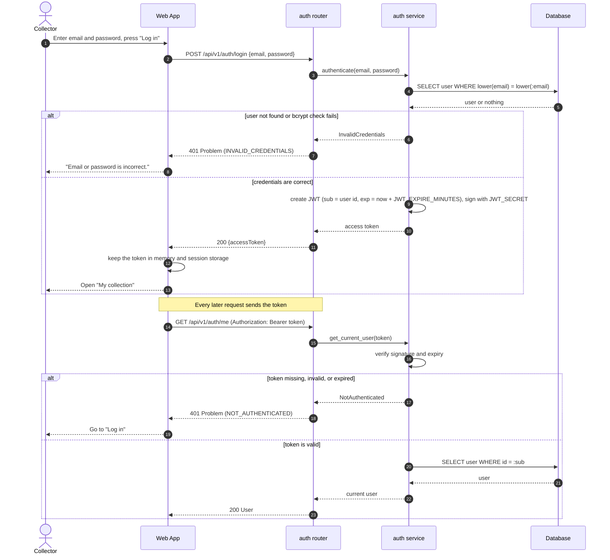
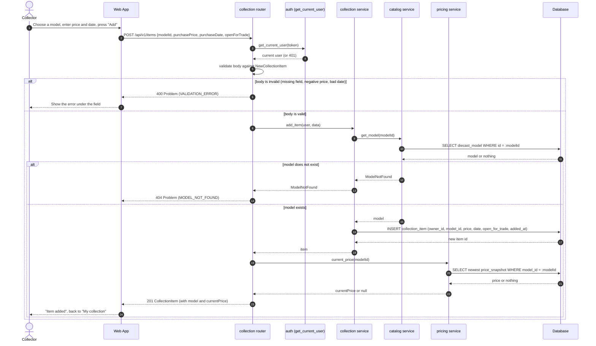
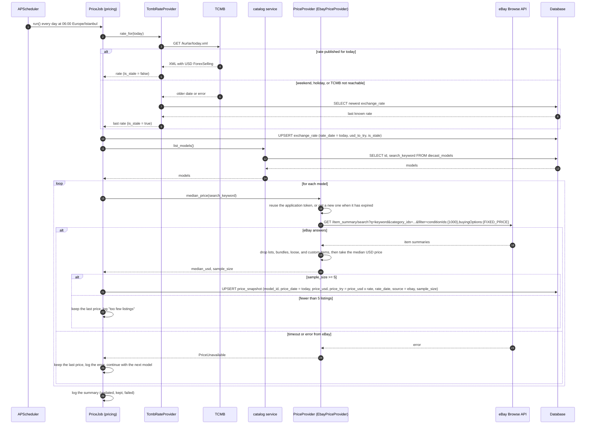
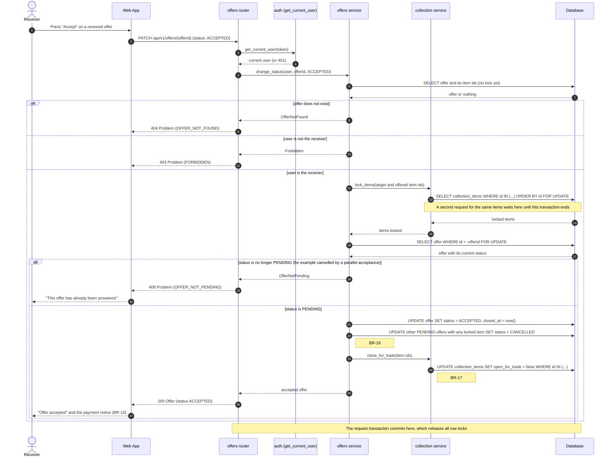

# UML Diagrams

| Field | Value |
|---|---|
| Project | CollecTree |
| Course | BM 321 / SENG 321 Software Engineering — Sprint 2 |
| Version | 0.2.0 (draft) |
| Owner (Accountable) | Berke Akman — Lead Software Architect |
| Consulted | Ata Eren Atlı (Implementation), Kemal Yusuf Ateşer (QA) |
| Informed | Elif Zahide Arat (Product Owner), Feyza Sayar (Scrum Master), Çağrı Baynal (DevOps) |
| Sources | [C4 model](c4-model.md), [domain model](domain-model.md), [`api/openapi.yaml`](../../api/openapi.yaml), [ADR-001](../adr/ADR-001-architecture-style-and-technology-stack.md) |

This document holds the UML behaviour diagrams of CollecTree. The structural UML diagrams are in the [domain model](domain-model.md): the class diagram (section 1), the database schema (section 2), and the offer state diagram (section 3.1).

| Diagram | Type | Section |
|---|---|---|
| Log in and call a protected endpoint | Sequence | 1 |
| Add an item to the collection | Sequence | 2 |
| Daily price job | Sequence | 3 |
| Accept an offer | Sequence | 4 |

**Participants** follow the C4 model, Level 3: the Web App container, the router (HTTP layer) and service (business rules) of each backend module, and the database. `BR-xx` refers to the business rules in the [domain model](domain-model.md#3-business-rules).

---

## 0 Conventions for every request

These rules apply to every flow below and are not repeated in each diagram.

| Topic | Rule |
|---|---|
| Transaction | Each HTTP request uses one database session and one transaction. The transaction is committed when the router returns successfully and rolled back on any error. |
| Errors | Every error is returned as `application/problem+json` with the `Problem` schema from `api/openapi.yaml` (`title`, `status`, `code`, `detail`). |
| Validation errors | FastAPI returns `422` for invalid request bodies by default. The contract uses `400`. A handler in `core` converts every validation error into `400` with the code `VALIDATION_ERROR`. |
| Authentication | Protected endpoints use one FastAPI dependency, `get_current_user` in `auth`. It returns `401` before the router code runs if the token is missing, invalid, or expired. |
| Lock order | When a request locks rows, it always locks **collection items first, in ascending id order, and offers after them**. All flows that change items or offers follow this order, so two requests can never wait for each other forever (deadlock). |

---

## 1 Log in and call a protected endpoint

**Design notes**
- An unknown email and a wrong password return the **same** `401` and message, so an attacker cannot find out which emails are registered.
- Passwords are compared with bcrypt; the plain password is never stored or logged (NFR-SEC-01).
- The token only carries the user id and the expiry time. No personal data is put into the token, because anyone holding it can read it.

---

## 2 Add an item to the collection

**Design notes**
- `collection` checks the model through the `catalog` service and never reads the `diecast_models` table itself (C4 model, dependency rule 1).
- The router, not the `collection` service, adds `currentPrice` from `pricing`. `collection` is lower than `pricing` in the dependency order, so its service may not call `pricing` (dependency rules 2 and 3).
- The response is for the owner, so it contains the purchase price and date. The same item listed for another user leaves them out (BR-02).

---

## 3 Daily price job

**Design notes**
- One request per **model**, not per collection item: a model owned by many users is priced once (US-08).
- `UPSERT` on (`model_id`, `price_date`) means that running the job twice on one day does not create duplicate prices (BR-15).
- One failing model never stops the job (NFR-REL-01). A missing rate never stops the job either: the last rate is reused and marked as stale (NFR-REL-02).
- Nothing from eBay is stored except the median and the sample size: no listing, seller, or user data ([domain model](domain-model.md), section 2.2).
- With `PRICE_PROVIDER=seed`, `SeedPriceProvider` takes the place of `EbayPriceProvider` and returns the TRY price from the seed file. Tests always use it, so no test calls eBay or TCMB.

---

## 4 Accept an offer

The most complex flow. It must stay correct when two offers for the same item are accepted at the same moment (NFR-REL-03).

**Design notes**
- **Why items are locked before the offer:** if two requests locked their own offers first and then tried to cancel each other's offers, each would wait for the other forever. Locking the shared items first, in ascending id order, makes the second request wait at step 13 until the first one has finished. It then reads its own offer, finds it `CANCELLED`, and returns `409`.
- The status is read again **after** the locks are taken. The first read (step 6) is only used to find the items and to check the receiver; it can be out of date by the time the locks are granted.
- `offers` changes items only through the `collection` service (`lock_items`, `close_for_trade`), never by writing `collection_items` itself (C4 model, dependency rule 1).
- Rejecting and withdrawing use the same flow without the cancel and close steps. Removing an item (BR-05), closing it for trade (BR-18), and creating an offer lock the same item rows in the same order, so they cannot slip in between.
- Accepting moves no items and no money (BR-10). The web app shows the notice that the users complete the exchange themselves.
