# User Flows

| Field | Value |
|---|---|
| Project | CollecTree |
| Course | BM 321 / SENG 321 Software Engineering, Sprint 2 |
| Version | 0.2.0 |
| Owner (Accountable) | Ata Eren Atlı, Implementation and Integration Engineer |
| Consulted | Berke Akman (Architect), Kemal Yusuf Ateşer (QA), Elif Zahide Arat (Product Owner) |
| Sources | [`api/openapi.yaml`](../../api/openapi.yaml), [domain model](../architecture/domain-model.md) (business rules BR-01 to BR-19), [C4 model](../architecture/c4-model.md) |

This document shows how a user moves through the main screens of CollecTree. Each flow names the API operation behind every step, the status code of every error, and the business rule (BR-xx) that causes it. The Figma prototype, the frontend, and the API tests use the same steps and the same on-screen messages.

**Notation:** rectangles are screens or system actions, diamonds are decisions, and red boxes are error or empty states shown to the user. Operation IDs from `api/openapi.yaml` are written in brackets, for example `[addItem]`.

---

## 1 On-screen messages

The flows, the Figma screens, and the API tests use exactly these messages.

| Case | API | Rule | Message on screen |
|---|---|---|---|
| Username or email already used | 409 | BR-01 | `This username or email is already registered.` |
| Wrong email or password | 401 | – | `Email or password is incorrect.` |
| Item in a pending offer cannot be removed | 409 | BR-05 | `This item is part of a pending offer. Accept, reject, or withdraw the offer first.` |
| Item cannot be closed for trade | 409 | BR-18 | `This item has pending offers. Accept or reject them before closing it for trade.` |
| Item not open for trade | 409 | BR-07 | `This item is not open for trade.` |
| Offer on own item | 403 | BR-07 | `You cannot make an offer for your own item.` |
| Empty offer | 400 | BR-06 | `Add at least one of your items or a cash amount.` |
| Offer no longer pending | 409 | BR-09 | `This offer has already been answered.` |
| Conversation already exists | 409 | BR-12 | No message: the existing conversation is opened instead. |
| Empty collection | – | – | `No items yet. Add your first model.` |

Field validation errors (`400`) are shown under the field that caused them, using the `detail` text of the `Problem` response.

---

## 2 Register and log in

Operations: `register`, `login`.

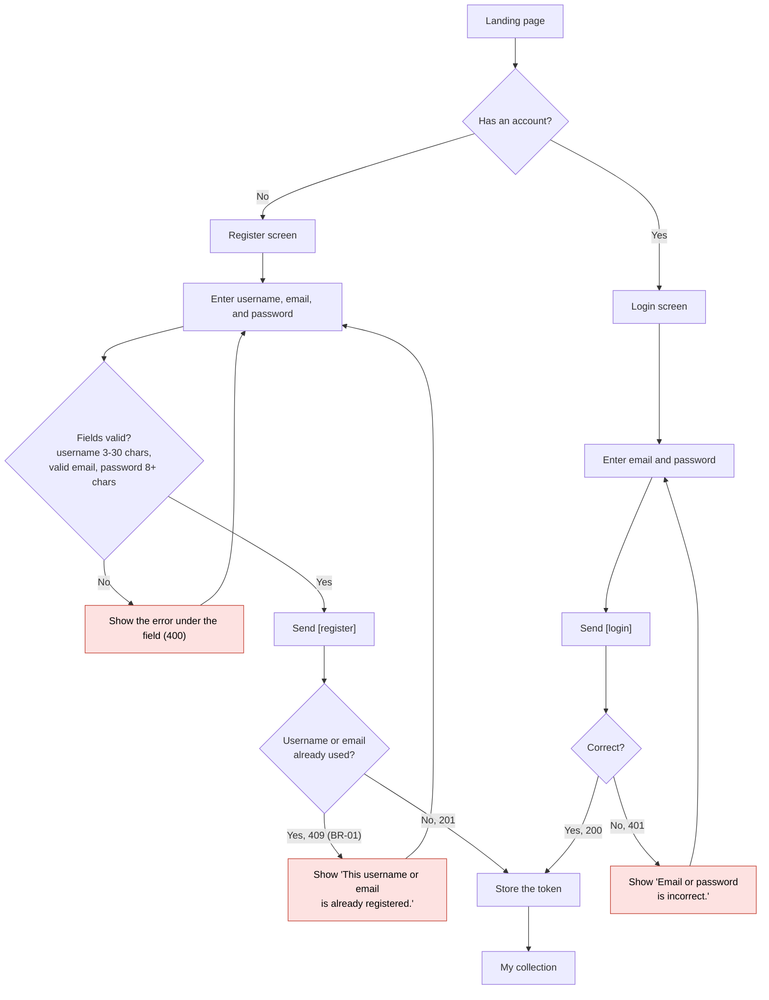

---

## 3 Add an item

Operations: `listUserItems`, `searchModels`, `addItem`.

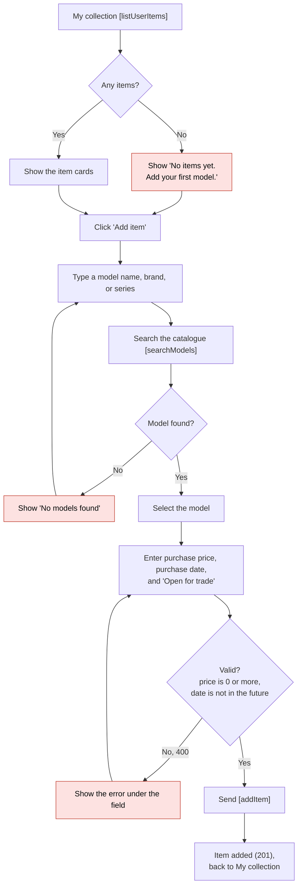

---

## 4 Edit or remove an item

Operations: `updateItem` (`PATCH /items/{itemId}`), `deleteItem`.

Only the owner sees the edit and remove actions (BR-03, BR-19). The model of an item cannot be changed; the owner removes the item and adds a new one instead (BR-19).

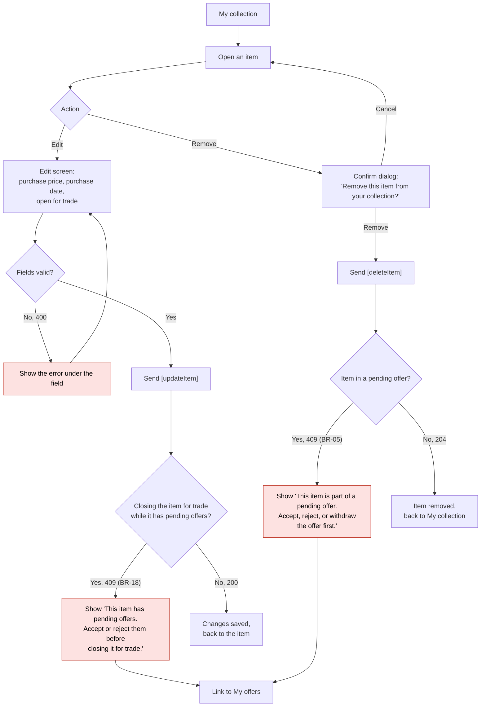

---

## 5 View the portfolio

Operations: `getMyPortfolio`, `getMyPortfolioHistory`, `getPriceHistory`.

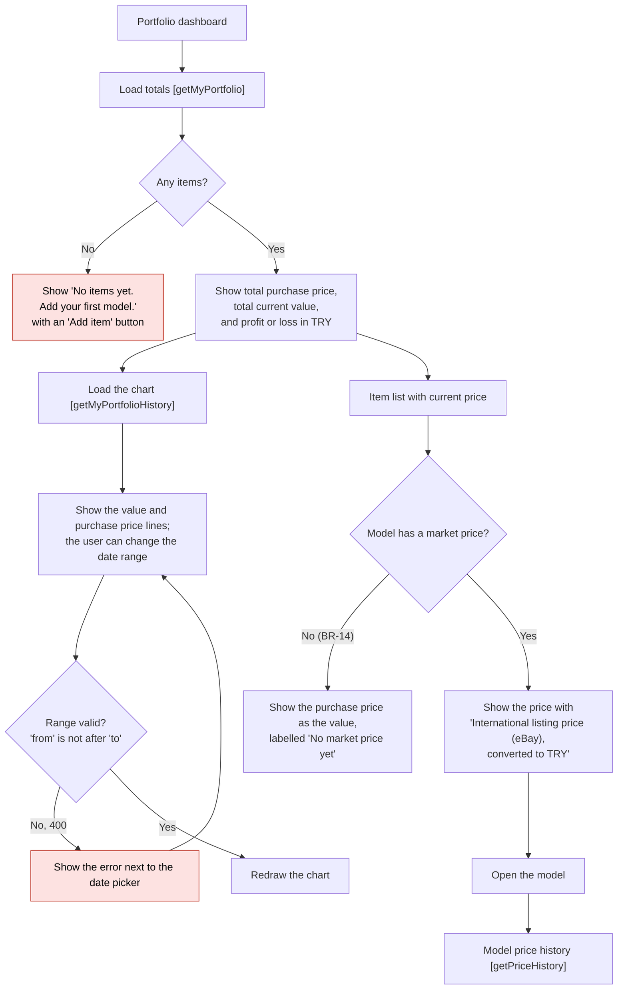

A model without a market price adds zero profit or loss, because its purchase price is used as its current value (BR-14).

---

## 6 Browse a collector and make an offer

Operations: `getUserProfile`, `listUserItems`, `createOffer`.

Purchase prices and purchase dates of other users are never shown (BR-02).

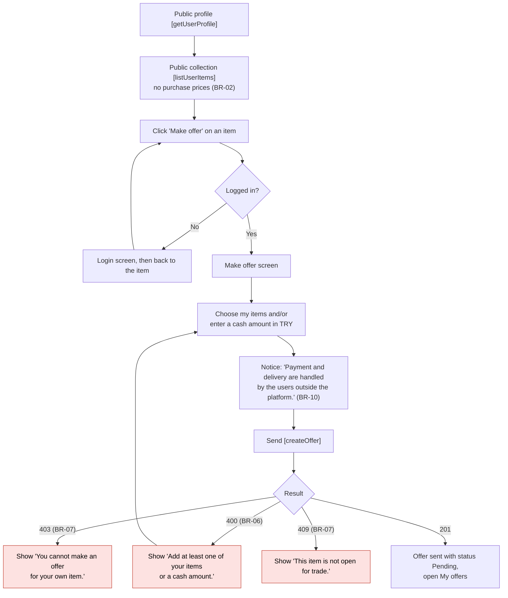

In the interface, the "Make offer" button is hidden on the user's own items and on items that are not open for trade. The 403 and 409 errors can still happen if the data changed after the page was loaded, so the screen must show them.

---

## 7 Respond to an offer

Operations: `listMyOffers`, `updateOfferStatus`.

Offer statuses on screen: **Pending**, **Accepted**, **Rejected**, **Withdrawn**, **Cancelled**.

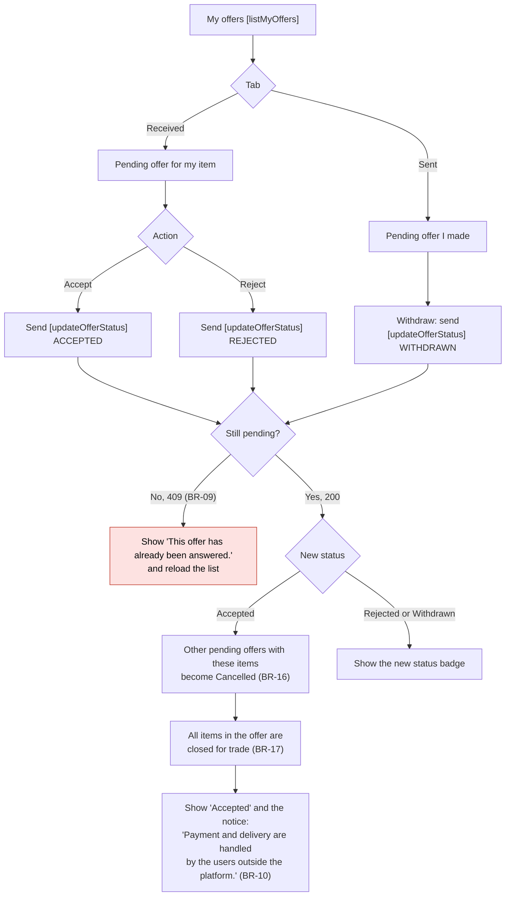

Only the receiver sees Accept and Reject; only the sender sees Withdraw (BR-09). Users never set **Cancelled**; only the system sets it (BR-09, BR-16).

---

## 8 Messaging

Operations: `listConversations`, `startConversation`, `listMessages`, `sendMessage`.

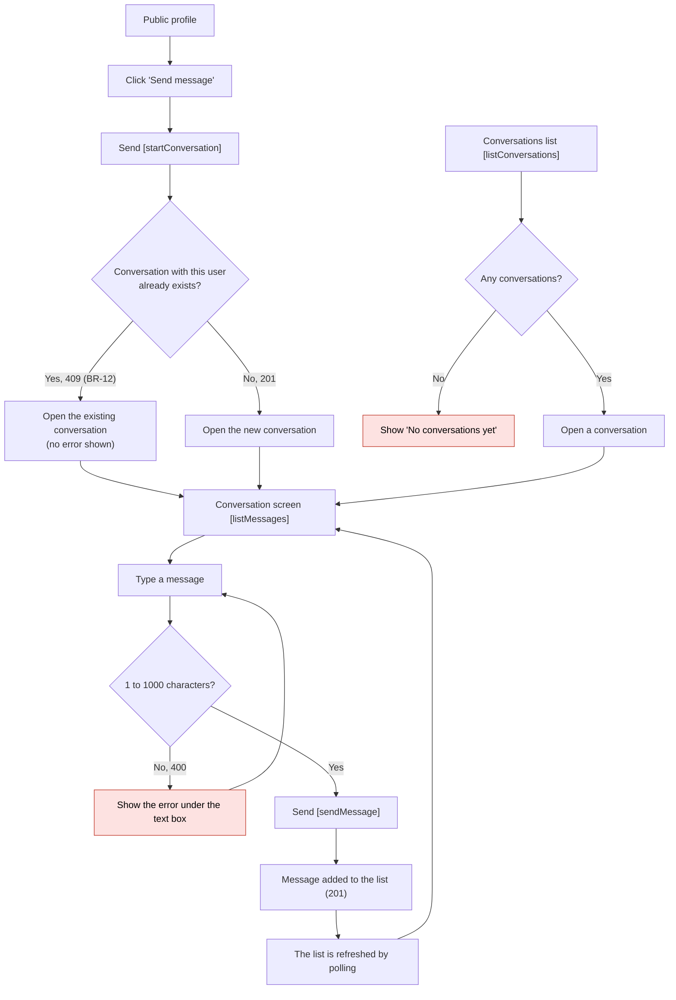

Only the two users of a conversation can read or send its messages (BR-11). Messages are refreshed by polling, not WebSocket (ADR-001).

---

## 9 Figma prototype and screens

- **Figma file (`CollecTree – Sprint 2 Prototype`, view and comment):** [https://www.figma.com/design/kpeIcUYw4x5FKOvrRbYFaM/CollecTree-Sprint-2-Prototype?node-id=24-2](https://www.figma.com/design/kpeIcUYw4x5FKOvrRbYFaM/CollecTree-Sprint-2-Prototype?node-id=24-2)
- **Interactive prototype (`Main Collector Journey`: Login → My Collection → Add Item → Portfolio Dashboard → Model Price History → Public Profile → Make Offer → My Offers → Conversations List → Conversation):** [https://www.figma.com/proto/kpeIcUYw4x5FKOvrRbYFaM/CollecTree-Sprint-2-Prototype?page-id=24%3A2&node-id=24-4&starting-point-node-id=24%3A4](https://www.figma.com/proto/kpeIcUYw4x5FKOvrRbYFaM/CollecTree-Sprint-2-Prototype?page-id=24%3A2&node-id=24-4&starting-point-node-id=24%3A4)

All 12 desktop screens (`1440×900`) are stored in [`docs/design/screens/`](screens/) and map to the API operations as follows:

| # | Screen | File | API operations | Flows |
|---|---|---|---|---|
| 1 | Login | [`01-login.png`](screens/01-login.png) / [`01-login.svg`](screens/01-login.svg) | `login` | Section 2 |
| 2 | Register | [`02-register.png`](screens/02-register.png) / [`02-register.svg`](screens/02-register.svg) | `register` | Section 2 |
| 3 | My collection (list + brand/scale/series filters) | [`03-my-collection.png`](screens/03-my-collection.png) / [`03-my-collection.svg`](screens/03-my-collection.svg) | `listUserItems` | Sections 3, 4 |
| 4 | Add item (catalogue search + price/date form) | [`04-add-item.png`](screens/04-add-item.png) / [`04-add-item.svg`](screens/04-add-item.svg) | `searchModels`, `addItem` | Section 3 |
| 5 | Edit item (price, date, open for trade) | [`05-edit-item.png`](screens/05-edit-item.png) / [`05-edit-item.svg`](screens/05-edit-item.svg) | `updateItem`, `deleteItem` | Section 4 |
| 6 | Portfolio dashboard (total value, profit/loss, history chart) | [`06-portfolio-dashboard.png`](screens/06-portfolio-dashboard.png) / [`06-portfolio-dashboard.svg`](screens/06-portfolio-dashboard.svg) | `getMyPortfolio`, `getMyPortfolioHistory` | Section 5 |
| 7 | Model price history | [`07-model-price-history.png`](screens/07-model-price-history.png) / [`07-model-price-history.svg`](screens/07-model-price-history.svg) | `getPriceHistory` | Section 5 |
| 8 | Public profile and collection (no purchase prices) | [`08-public-profile.png`](screens/08-public-profile.png) / [`08-public-profile.svg`](screens/08-public-profile.svg) | `getUserProfile`, `listUserItems` | Sections 6, 8 |
| 9 | Make offer (choose my items and/or cash) | [`09-make-offer.png`](screens/09-make-offer.png) / [`09-make-offer.svg`](screens/09-make-offer.svg) | `createOffer` | Section 6 |
| 10 | My offers (sent / received, status badges) | [`10-my-offers.png`](screens/10-my-offers.png) / [`10-my-offers.svg`](screens/10-my-offers.svg) | `listMyOffers`, `updateOfferStatus` | Section 7 |
| 11 | Conversations list | [`11-conversations-list.png`](screens/11-conversations-list.png) / [`11-conversations-list.svg`](screens/11-conversations-list.svg) | `listConversations`, `startConversation` | Section 8 |
| 12 | Conversation | [`12-conversation.png`](screens/12-conversation.png) / [`12-conversation.svg`](screens/12-conversation.svg) | `listMessages`, `sendMessage` | Section 8 |

### 9.1 Screen previews

#### 1. Login (`login`)
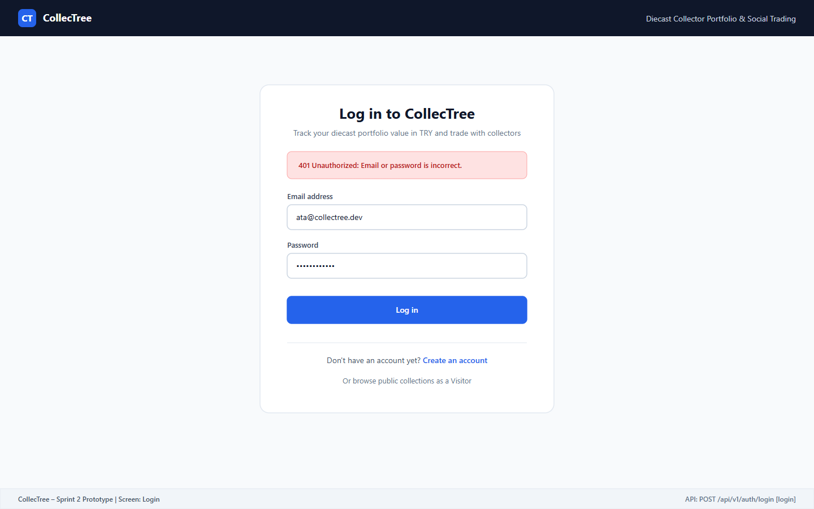

#### 2. Register (`register`)
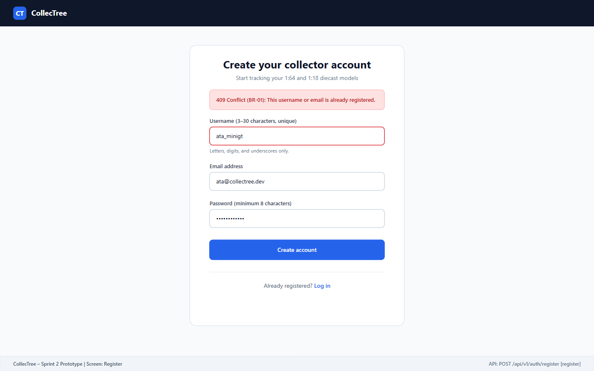

#### 3. My Collection (`listUserItems`)
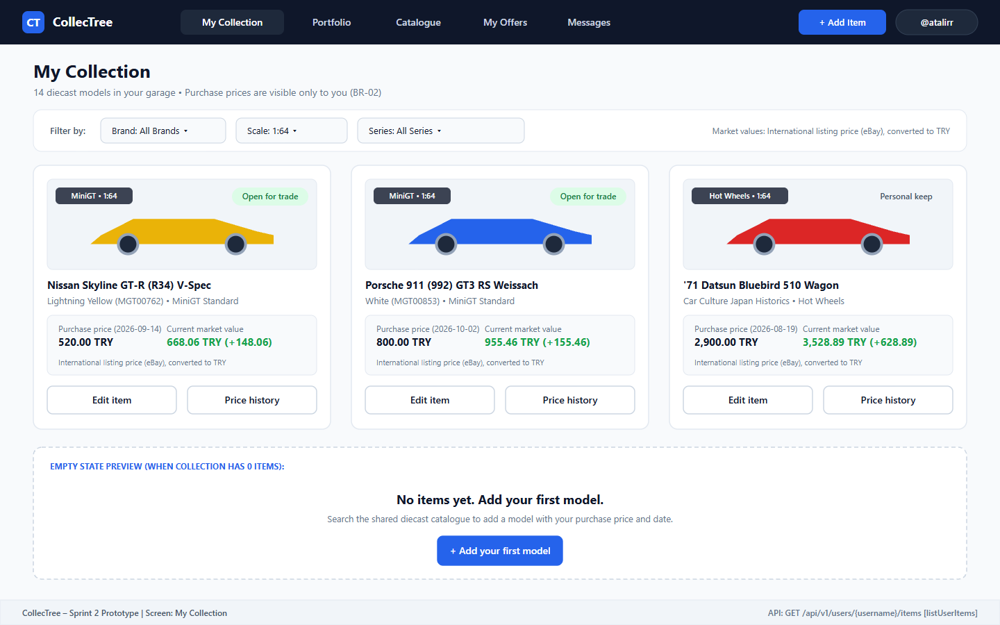

#### 4. Add Item (`searchModels`, `addItem`)
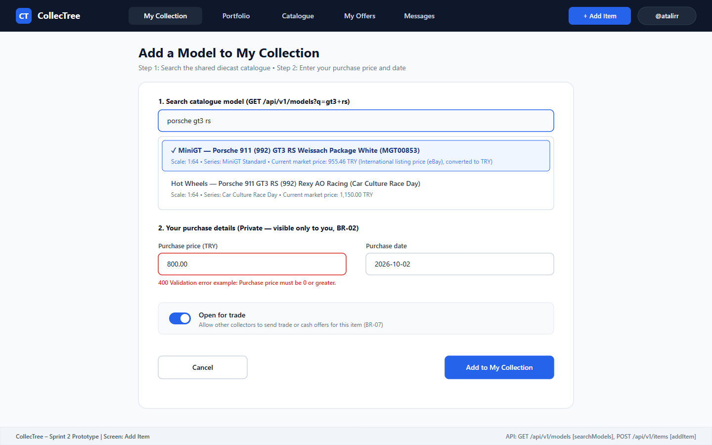

#### 5. Edit Item (`updateItem`, `deleteItem`)
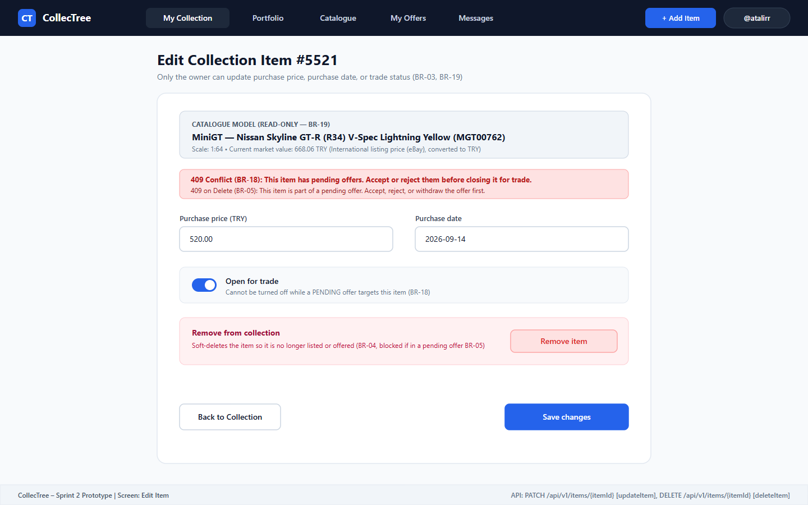

#### 6. Portfolio Dashboard (`getMyPortfolio`, `getMyPortfolioHistory`)
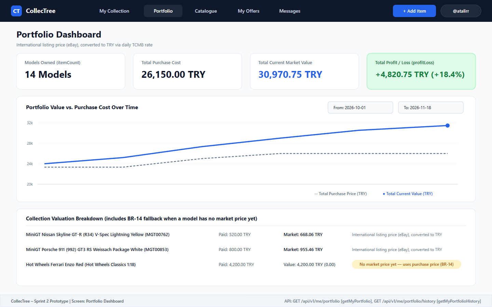

#### 7. Model Price History (`getPriceHistory`)
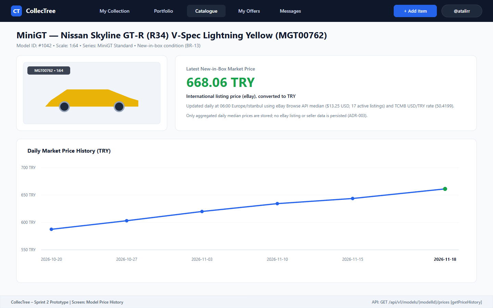

#### 8. Public Profile and Collection (`getUserProfile`, `listUserItems`)
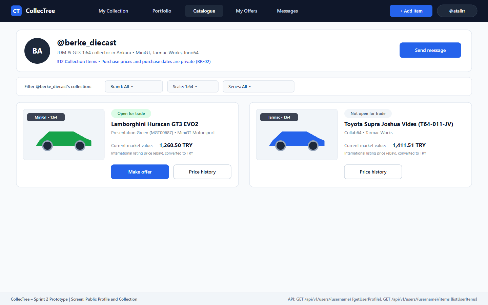

#### 9. Make Offer (`createOffer`)
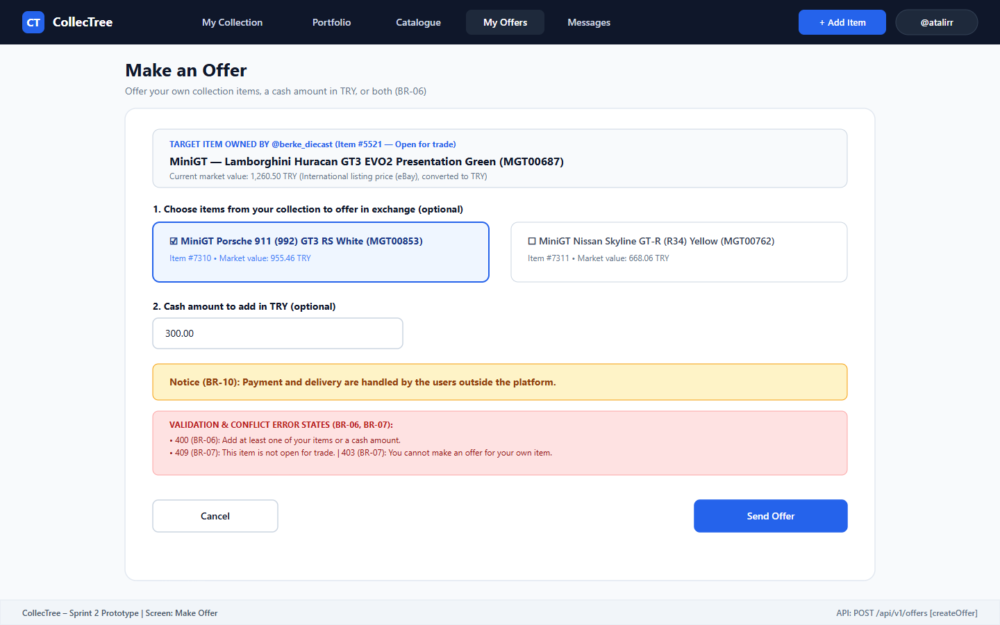

#### 10. My Offers (`listMyOffers`, `updateOfferStatus`)
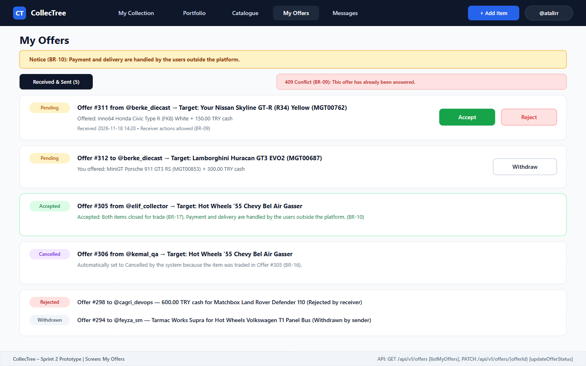

#### 11. Conversations List (`listConversations`, `startConversation`)
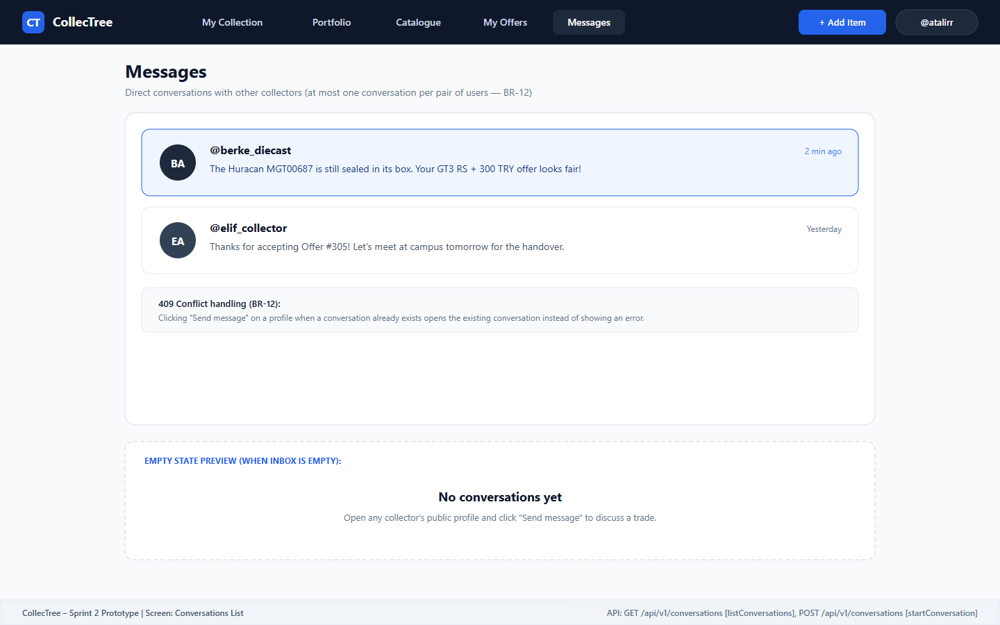

#### 12. Conversation (`listMessages`, `sendMessage`)
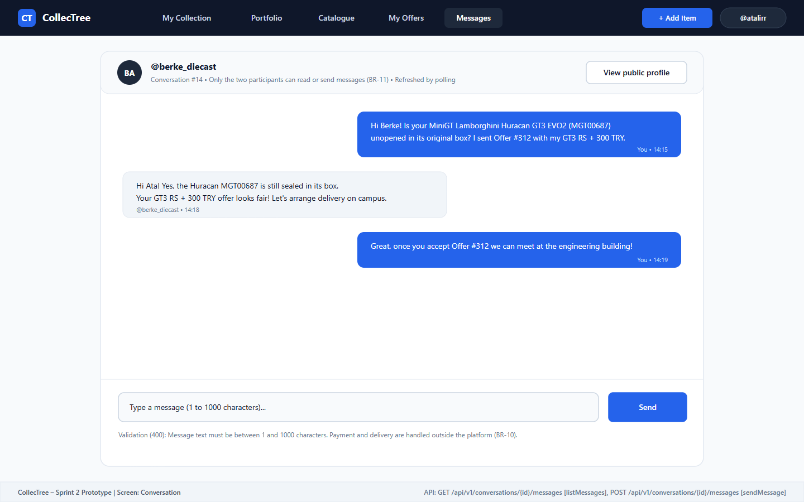
